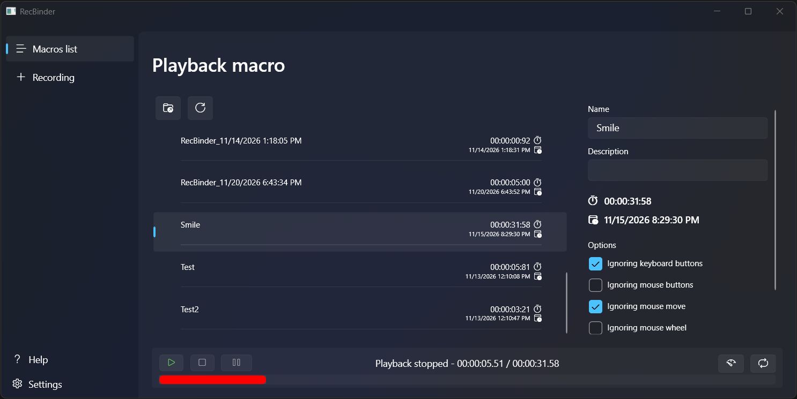
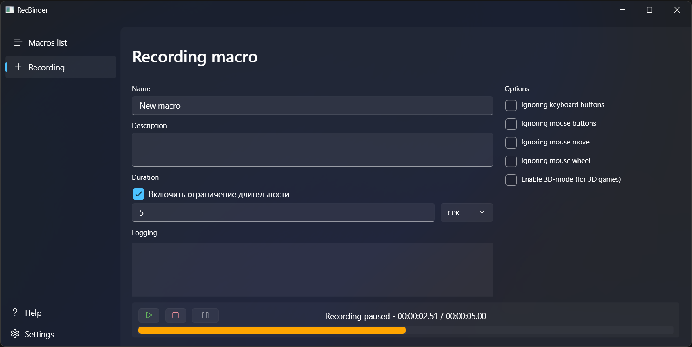
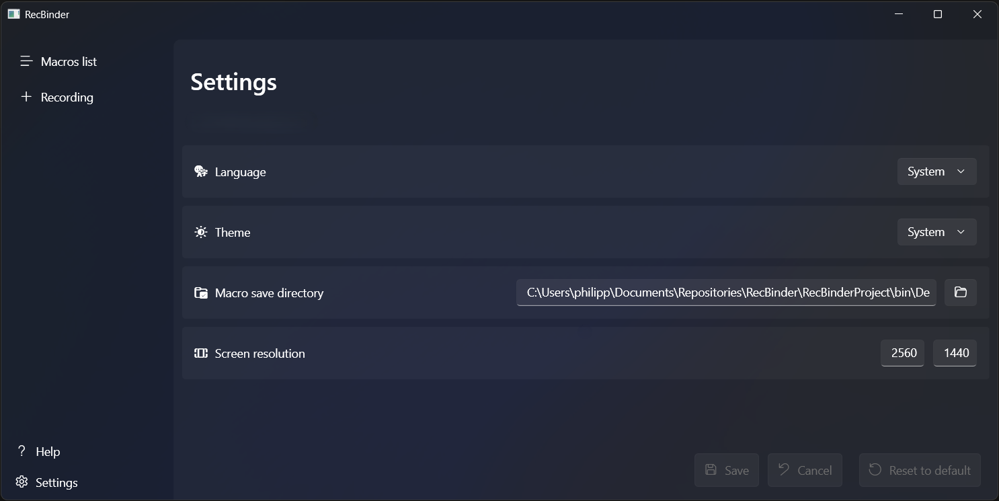

# RecBinder

RecBinder - настольное приложение для Windows, которое записывает действия клавиатуры и мыши в макросы и позволяет воспроизводить их позже. Проект создан как pet-проект и демонстрирует разделение приложения на слои, применение MVVM и внедрение зависимостей.

## Демонстрация

https://github.com/user-attachments/assets/96a27d52-8457-4001-ad17-9eed163fe283

## Скриншоты

| Библиотека макросов |
| --- |
|  |

| Запись макроса | Настройки приложения |
| --- | --- |
|  |  |

## Возможности

- Запись нажатий клавиш, нажатий кнопок мыши, перемещения курсора и прокрутки колеса.
- Пауза, возобновление и остановка записи или воспроизведения.
- Сохранение и загрузка макросов в формате JSON; просмотр библиотеки и удаление макросов.
- Настройка параметров воспроизведения: скорость, циклы и задержка между циклами, относительное перемещение мыши и фильтрация типов событий.
- Настройка параметров записи, включая фильтрацию событий и режим фиксации движения мыши.
- Поддержка глобальных горячих клавиш для запуска и остановки записи и воспроизведения.
- Настройки языка (русский, английский или системный) и темы (светлая, тёмная или системная).

## Технологии

- C# и .NET 10 (`net10.0-windows`)
- WPF и XAML
- MVVM
- Microsoft.Extensions.DependencyInjection — внедрение зависимостей
- Microsoft.Extensions.Logging — логирование
- System.Text.Json — хранение макросов и настроек
- NuGet's H.InputSimulator и MouseKeyHook — симуляция и перехват ввода

## Архитектура

| Область | Ответственность |
| --- | --- |
| `Domain` | Модель макроса, метаданные и типы событий ввода. |
| `ApplicationLayer` | Контракты и сценарии приложения: запись/воспроизведение, репозиторий макросов, настройки и горячие клавиши. |
| `Infrastructure` | Реализации сервисов, работа с вводом и файлами, JSON-сериализация и регистрация зависимостей. |
| `Presentation` | WPF-представления и ViewModel по паттерну MVVM, команды и UI-сервисы. |

## Примечания

При первом запуске приложение создаёт `settings.json` рядом с исполняемым файлом. По умолчанию файлы макросов сохраняются в каталоге `Macros` рядом с приложением, путь можно изменить в настройках.